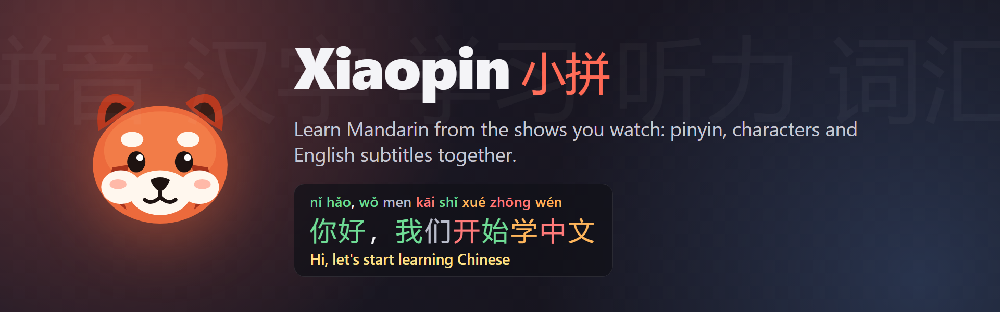
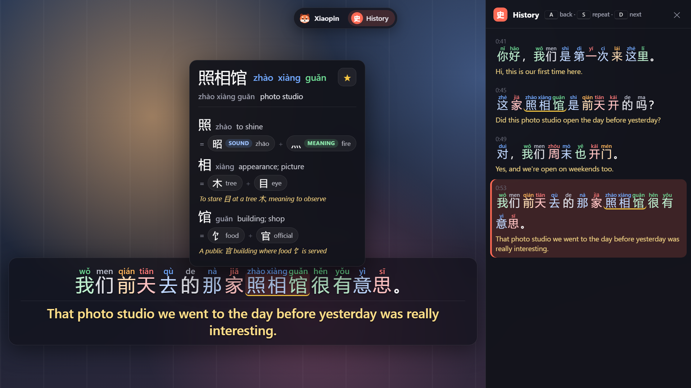

# Xiaopin 小拼 – Pinyin Subtitles for Crunchyroll & YouTube

A free, open-source Chrome extension for learning Mandarin Chinese from the videos you already watch. It shows every line as **pinyin → 汉字 → English** with tone colours, lets you hover any word for its meaning and character breakdown, and keeps a word list you can export to Anki. A lightweight Language Reactor alternative focused on Chinese.

Meet **Xiaopin**, the red panda (小熊猫) who reads along with you.



<sub>Screenshot of the overlay on a demo page (`docs/demo.html`) with example sentences, not footage from any show.</sub>

> Unofficial project. Not affiliated with, endorsed by or sponsored by Crunchyroll, YouTube/Google, Language Reactor or any other company. All trademarks belong to their owners and are used only to say which sites the extension works on.

## Features

- **Three-line subtitles**: pinyin above each character, then Chinese characters, then English.
- **Tone colours**: 1st tone red · 2nd orange · 3rd green · 4th blue · neutral grey, on both pinyin and characters, so tones stick visually.
- **Hover a word** for pinyin and meanings (CC-CEDICT). The video pauses while you read.
- **Character breakdown**: see how each character is built from simpler parts, which part gives the meaning and which the sound (好 = 女 woman + 子 child; 妈 = 女 meaning + 马 sound). Click a part to drill down.
- **Dictionary-based word splitting**: 前天, 照相馆 and 一点儿 stay one word; idioms stay whole.
- **History panel**: every line so far with pinyin, characters and English; click a line to jump back.
- **Word list**: save words with ☆ together with the sentence they came from. Export to Anki or CSV.
- **Listening keys**: `A` previous line · `S` repeat line · `D` next line.
- **Video, History or Both**: show subtitles on the video, only in the history panel (clean picture), or both. One click in the toolbar or key `H`.
- **Move things around**: drag the word popup by its header and it stays open where you put it (✕ or `Esc` closes it); drag the history panel to float it and resize it at the corner. Double-click a header to put it back.
- **Known words**: mark words as new, learning, known or ignored (popup buttons or keys `1`–`4`). New words get a blue dotted underline, words you are learning an amber one.
- **Comprehension %**: the toolbar shows how much of the episode's vocabulary you already know, so you can pick videos at your level. Beginners can count HSK 1–N as known.
- **HSK levels**: every word's HSK 2.0 level in the popup, optionally as a small badge on the word.
- **Shadowing**: pause automatically after each line, loop a line 2×/3×/5×/∞ (`R` to loop the current line), and blur English or pinyin until you hover (`B` to peek).
- **In plain words**: at the top of the word popup, a short AI explanation of the word as used in this sentence, with a memory tip built on its character parts. In English or Dutch (Nederlands), cached per word and sentence.
- **Explain this line (解)**: an AI breakdown of the sentence: translation, word-by-word gloss and grammar points. Key `E`. Cached, so each line costs once.
- **Stroke order**: animated stroke order for every character in the word popup, plus a trace mode to practise writing.
- **Send to Anki (卡)**: one click creates a word or sentence card through AnkiConnect, with tone-coloured pinyin, the sentence, and audio from Anki's own text-to-speech.
- **Missing a language?** If a video only has Chinese or only English subtitles, the other side is translated with an AI model of your choice (OpenRouter or Anthropic API, your own key). Translations are made once per episode and cached locally, starting from where you are watching so subtitles don't lag.
- **Your own subtitle file**: load a Chinese `.srt`/`.ass` file and shift its timing if needed.

### Where the text comes from

| Site | Chinese | English |
| --- | --- | --- |
| Crunchyroll | Chinese subtitle track if the episode has one, else your own file, else AI translation | the episode's English track |
| YouTube | the video's Chinese captions (turned on automatically) | English captions if loaded, else AI translation |

If a stream already has English burned into the picture, the extension hides its own English line and places pinyin + characters above it.

## Install

[](https://github.com/pim97/Language-Reactor-alternative/actions/workflows/build.yml)
[](https://github.com/pim97/Language-Reactor-alternative/releases/latest)

1. Download **`xiaopin-<version>.zip`** from the [latest release](https://github.com/pim97/Language-Reactor-alternative/releases/latest) and unzip it.
2. Open `chrome://extensions` (also works in Edge and Brave), turn on **Developer mode** and click **Load unpacked**. Pick the unzipped `xiaopin-<version>` folder.
3. Click the extension icon to open the settings. Add an OpenRouter or Anthropic API key if you want AI translation. The default model is Claude Haiku 5.5 (fast, accurate, about half a cent per episode).

## Privacy and what it does not do

- It **only reads subtitle data that the site's own player already loaded** in your browser session. It does not download, record or decrypt video or audio, and does not bypass DRM, paywalls or region locks. You need your own account and subscription.
- Subtitles, translations and your word list are stored **only in your browser** (`chrome.storage`). Nothing is uploaded or shared, except the subtitle lines you choose to send to your AI provider for translation.
- Your API key is stored locally and sent only to the provider you pick.
- This repository contains **no subtitles, video or screenshots** from any show.

Use it for personal study, in line with the terms of the sites you watch.

To update, download the new zip, replace the folder, and click ↻ on the extension in `chrome://extensions`. Your word list and settings are kept.

Prefer the latest code? Clone the repository and load the folder itself, or grab the zip from any [Actions run](https://github.com/pim97/Language-Reactor-alternative/actions/workflows/build.yml) under *Artifacts*.

### Verifying a release

Every release is built in public by the [Build extension](https://github.com/pim97/Language-Reactor-alternative/actions/workflows/build.yml) workflow. Nothing is uploaded by hand, and you can trace each zip back to the exact commit and run:

- **Release notes** link to the commit and to the workflow run that built the zip. That run's log and summary show every step, the SHA-256 and every file in the zip.
- **Build provenance**: each zip has a signed [GitHub attestation](https://docs.github.com/en/actions/security-for-github-actions/using-artifact-attestations) that says which repository, commit and workflow produced it. Check it with the GitHub CLI:
  ```
  gh attestation verify xiaopin-1.2.0.zip --repo pim97/Language-Reactor-alternative
  ```
- **Checksum**: `SHA256SUMS.txt` is attached to every release: `sha256sum -c SHA256SUMS.txt`.
- **Reproducible build**: the zip is byte-identical for the same commit (fixed file order, timestamps and permissions). CI builds it twice and fails if the two differ. To rebuild it yourself and compare the SHA-256:
  ```
  git clone https://github.com/pim97/Language-Reactor-alternative && cd Language-Reactor-alternative
  git checkout v1.2.0
  scripts/package.sh        # needs bash, git, node, zip, sha256sum (Linux/macOS/WSL)
  ```
- All GitHub Actions in the workflow are pinned to full commit SHAs.

### Making a release

Bump `version` in `manifest.json`, commit, then tag it: `git tag v1.2.1 && git push origin v1.2.1`. The workflow checks that the tag matches the manifest, builds, attests and publishes the release.

## How it works

| File | Role |
| --- | --- |
| `inject.js` | Runs in the page; reads the subtitle list / caption responses the player received. |
| `content.js` | Builds the overlay: pinyin, word spans, popup, history, word list, shortcuts. |
| `background.js` | Fetches subtitle files, AI translation, dictionary lookup and word splitting. |
| `subtitles.js` | Parsers for `.ass`, `.srt` and YouTube `json3`. |
| `options.html/js` | Settings and word list with Anki/CSV export. |
| `features/` | Learning tools as plugins (known words, shadowing, explain, strokes, Anki); see `features/README.md`. |
| `scripts/package.sh` | Reproducible build of the extension zip. |
| `assets/`, `icons/` | Xiaopin mascot and extension icons (original artwork, MIT like the code). |
| `docs/` | README banner, screenshot and the demo pages they are rendered from. |

## Licenses

The extension code is MIT licensed (see `LICENSE`). Bundled data and libraries keep their own licenses; see `THIRD_PARTY_NOTICES.md`.
